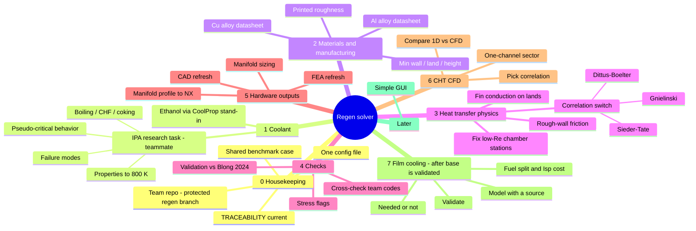

# Regen solver plan

Goal: a 1D regen sizing tool for a **printed chamber (Cu or Al)** that's good enough to hand
geometry to CAD and set up CHT CFD and FEA. 1D is for rough sizing; CFD and FEA have the final say.

Owner: Parthiv (regen solver). TCA lead: Louis DeSano.
Where it lives: branch `regen` of PURPL-Purdue/Turbopump, folder `MARLIN V2/Tenkara/4 - Subteams/TCA/Regen/`.
Merges: every pull request into `regen` needs approval from Parthiv or Louis (either one).
Rule: every new number or correlation gets a row in [TRACEABILITY.md](TRACEABILITY.md) with a source.

## Map

## Checklist

Status: `[ ]` todo · `[~]` in progress · `[x]` done. Each item has a done-when.

### 0. Housekeeping
- [x] **Local git cleaned up and committed** on `main` (old code kept on `archive/full-2026-10-01`). `requirements.txt` pins versions; every output records what made it.
- [ ] **`regen` branch in the team repo.** Branch `regen` off Turbopump's `main` (a snapshot: other teams' folders stay frozen on it, which is fine; they keep working on `main`). Copy the solver into `MARLIN V2/Tenkara/4 - Subteams/TCA/Regen/` on that branch. On `main`, put only a one-line README in `TCA/Regen/` pointing to the `regen` branch, so there's no unprotected copy.
  *Done when:* the solver runs from a fresh clone of `regen`.
- [ ] **Protect `regen`.** CODEOWNERS on the `regen` branch only, listing Parthiv and Louis for `TCA/Regen/` (GitHub reads CODEOWNERS from the branch a PR merges into, so `main` is unaffected). A repo admin turns on, for `regen` only: require a pull request, 1 approval, review from Code Owners, no force-push, no deletion.
  *Done when:* a pull request into `regen` can't merge without Parthiv's or Louis's approval, and nothing changed for other teams.
  *Needs:* both GitHub usernames; a Turbopump admin (who? ____).
- [ ] **Contributing section** in the README: the TRACEABILITY rule, how to run, and that changes go through pull requests into `regen`.
- [x] **TRACEABILITY.md current** with the regen.yaml inputs (updated 2026-11-21: O/F 1.4, T_wg_allow 750 K, 80% bell). Keep it current on every input change.
- [x] **Wall temp solver takes real geometry:** `geometry_file` in regen.yaml reads N, w(x), h(x) (e.g. `output/channel_geometry.csv` from the channel solver). The constant 36 × 2×1 mm values are only the fallback.
- [x] **Physics separated from run scripts:** physics in `engine/`, `heat_transfer/`, `jacket/`, `coolant/`; scripts in `scripts/`; printing and files in `util/`. Results identical to before the split.
- [x] **One config file** for all inputs (engine + jacket + channel).
### 1. Coolant
- [ ] **Ethanol module via CoolProp** (same interface as `ipa_props.py`). Decide: ethanol on both CEA and coolant, or label runs "IPA engine, ethanol coolant stand-in".
- [ ] **IPA research brief** written and assigned to: ____
  - Properties 290–800 K at 700–900 psi, cited, valid ranges given, CSV in `ipa_props` format
  - Pseudo-critical behavior, nucleate boiling / CHF, coking
  - Failure modes and the design limit each one sets
- [ ] **Review IPA research:** spot-check 2–3 points against an independent source.
- [ ] **Slot IPA table into the code**, rerun the benchmark.
- [ ] Find max heat flux coolant can take as well as the critical heat flux. Are these the same?
- [ ] Find IPA coefficients for sieder-tate (currently uses kerosense's coefficients)

### 2. Materials and manufacturing (decisions, need sources)
- [ ] Cu alloy: k(T), allowable T_wg, yield(T), E, α, from a datasheet
- [ ] Al alloy: same. Expect a separate design, not a material swap.
- [ ] Printed surface roughness (vendor or paper)
- [ ] Printer limits: min wall, min land, channel width/height range. max build height as well. 

### 3. Heat transfer physics
- [ ] **Correlation switch:** Sieder-Tate / Dittus-Boelter / Gnielinski, plus a comparison plot (the spread is the uncertainty band). The hook exists: add a function to `heat_transfer/coolant_side.py` CORRELATIONS and pick it with `jacket.coolant_htc`.
- [x] **Rough-wall friction** wired to the printed roughness
- [x] real friction factor calculated using colebrook and haaland
- [x] **Fin conduction on the lands** (fin efficiency)
- [ ] **Fix the low-Re chamber stations** (Re ≈ 1,000 from the 9.5 mm height limit)
- [ ] Model conduction into outer jacket
- [ ] How to factor in surface roughness into Liquid side heat transfer coefficient

### 4. Checks
- [ ] **Stress flags in the report:** hoop stress from Δp plus a thermal-strain estimate, vs yield at temperature
- [ ] get data to validate against: Prior NASA, PURPL, PSP data. 
- [ ] **Compare team codes** on the benchmark case

### 5. Hardware outputs
- [ ] **Manifold sizing:** manifold velocity head small compared with channel Δp
- [ ] **Manifold profile export to NX**
- [ ] **CAD refresh** from the current heights
- [ ] **FEA refresh** from the current CAD

### 6. CHT CFD
- [ ] One-channel periodic sector at a few stations (throat plus 2 others)
- [ ] Record mesh y+, turbulence model, property model
- [ ] Compare wall T, h, Δp against 1D; pick or calibrate the correlation

### 7. Film cooling
*Start when:* the base regen is validated (sections 3, 4 and 6 done). The film changes the gas-side boundary condition, so an unvalidated base hides what the film is doing. If film cooling turns out to be needed, redo section 5 (CAD, FEA) afterwards.
- [ ] **Needed or not.** Run the validated base at the final inputs.
  *Done when:* a clear yes or no, e.g. whether T_wg can be held at the limit everywhere without stations clamped at h_min, and whether the coolant Δp and outlet temperature are acceptable.
- [ ] Film model with a source: NASA CR-135052 seems very promising.
- [ ] **Fuel split and its cost:** film fraction, whether it's taken after the jacket or before it, the core O/F shift, and the c* / Isp penalty.
- [ ] **Validate** against film-cooled test data (source to find).
- [ ] **Injector hand-off:** film orifice count and size, for the injector design.

### Later
- [ ] Simple GUI (Streamlit) once inputs settle
